<p align="center">
  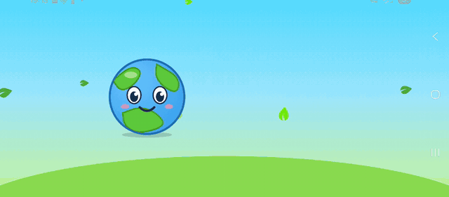
</p>

<p align="center">
  <a href="https://github.com/MahrazAbdelrahmen/EVERGREEN/releases/latest"></a>
  
  
</p>

## Projet 2CP - Jeu mobile pour la protection de l'environnement -

"EVERGREEN", le jeu mobile engagé pour la protection de l'environnement.

Avec Terry, la petite planète, les enfants apprennent à trier leurs déchets en jouant : puzzles, tri, quiz, défis du quotidien, un livre illustré et des histoires à écouter.

## Utilisé par

Ce jeu est utilisé par :
- Un public varié, y compris les enfants âgés de 7 ans et plus qui ont déjà acquis la capacité de lire. Offrant une expérience éducative divertissante, il encourage les jeunes à s'immerger dans un monde virtuel tout en apprenant les valeurs de la durabilité et de la préservation de notre planète.

## Aperçu

### Qui joue ?

Chaque enfant a son profil, avec son avatar, ses pièces et sa progression, sur l'appareil ou en ligne avec un compte parent.

<table>
  <tr>
    <td>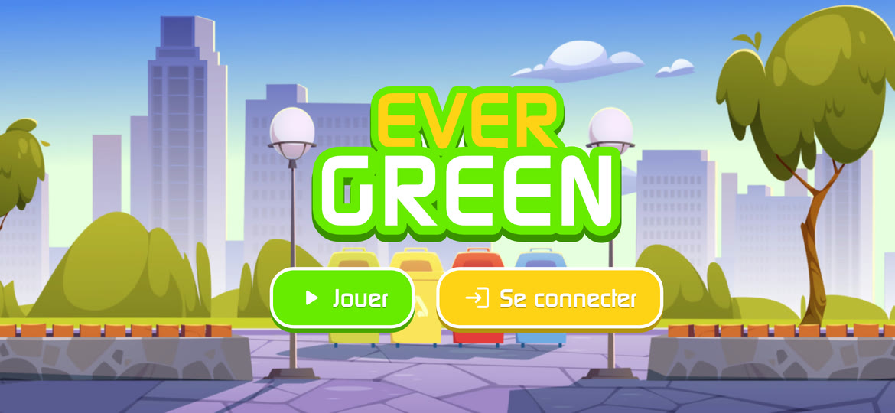</td>
    <td>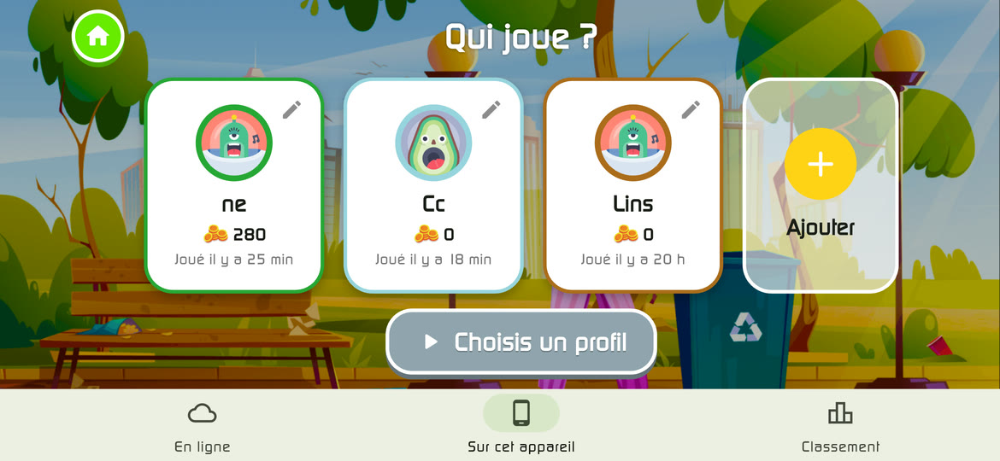</td>
  </tr>
  <tr>
    <td>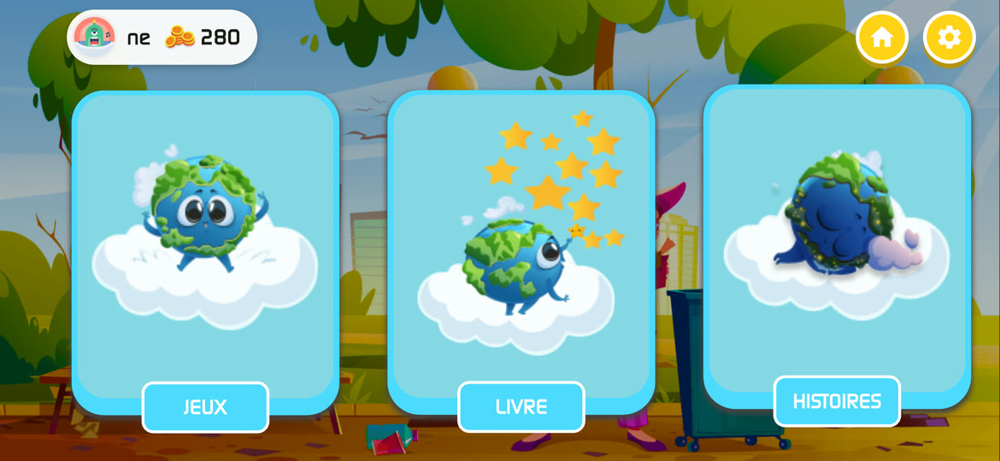</td>
    <td>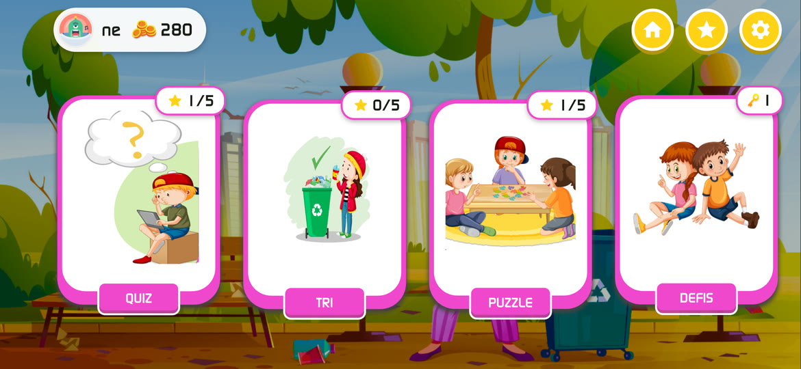</td>
  </tr>
</table>

### Puzzle

De vraies pièces de puzzle découpées, éparpillées autour du plateau, qui s'aimantent à leur place.

<table>
  <tr>
    <td width="60%">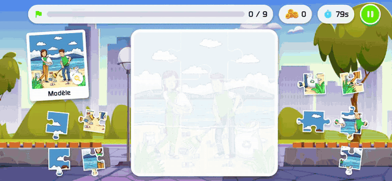</td>
    <td>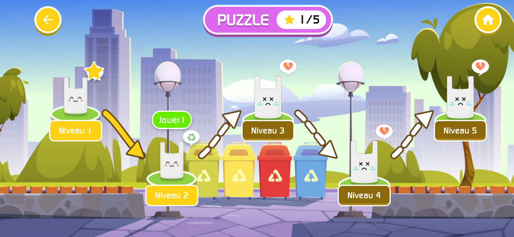<br />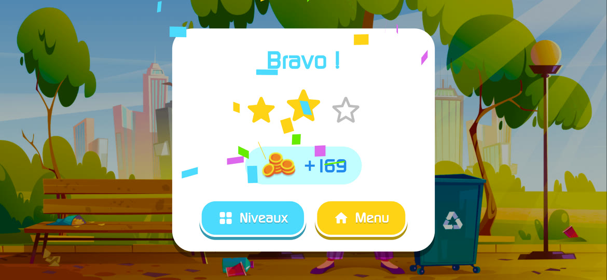</td>
  </tr>
</table>

### Tri

On glisse chaque déchet dans la bonne poubelle : la poubelle s'illumine en vert, ou en rouge en cas d'erreur.

<table>
  <tr>
    <td width="60%">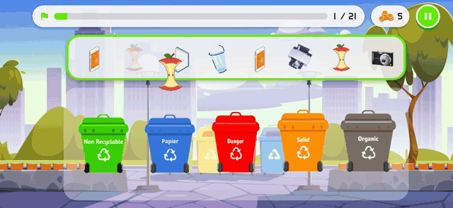</td>
    <td>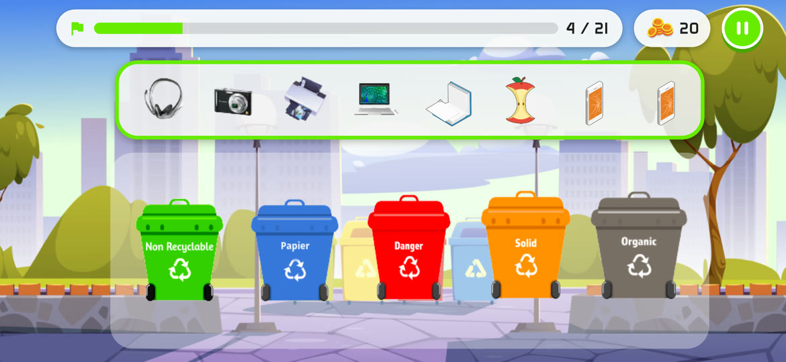</td>
  </tr>
</table>

### Quiz

Questions en images ou à choix multiples, avec la bonne réponse révélée et une explication lue à voix haute.

<table>
  <tr>
    <td width="60%">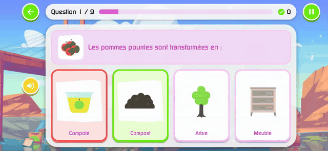</td>
    <td>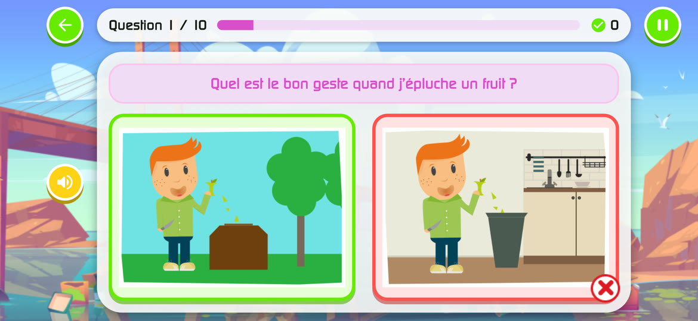<br />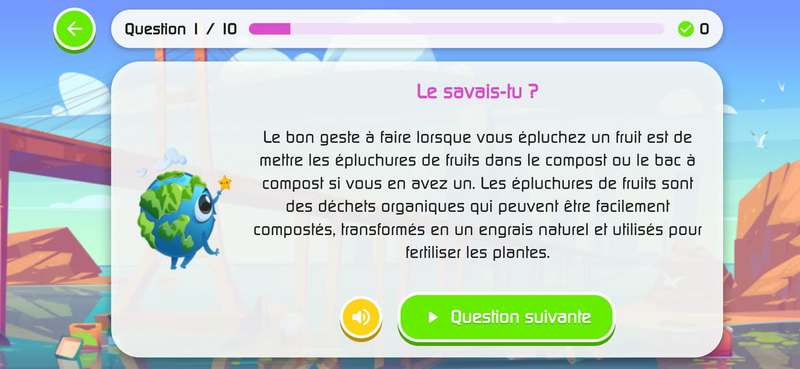</td>
  </tr>
</table>

### Livre

Un vrai livre dont on tourne les pages du bout du doigt, chapitre par chapitre : les poubelles, quoi recycler, pourquoi, conseils.

<table>
  <tr>
    <td width="60%"></td>
    <td>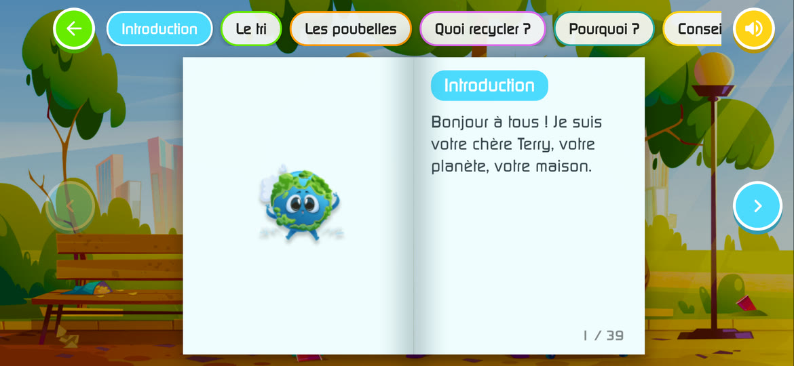<br />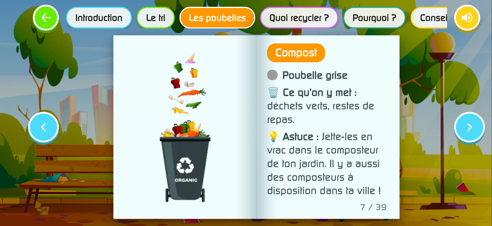</td>
  </tr>
</table>

### Défis, trophées et histoires

Un nouveau défi chaque jour, des trophées à collectionner, et des histoires narrées qui se débloquent avec les clés gagnées.

<table>
  <tr>
    <td>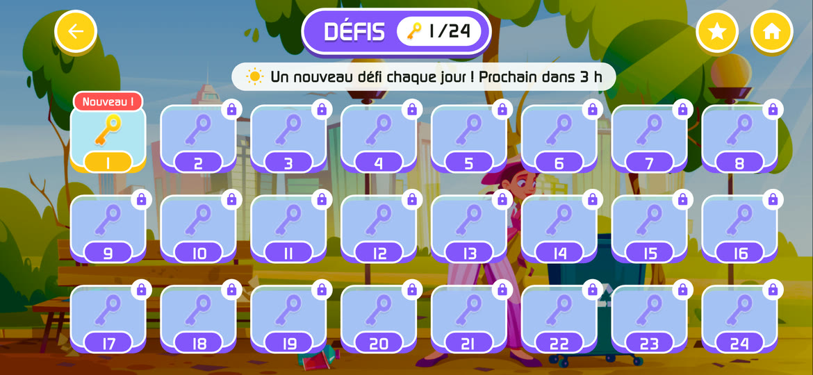</td>
    <td>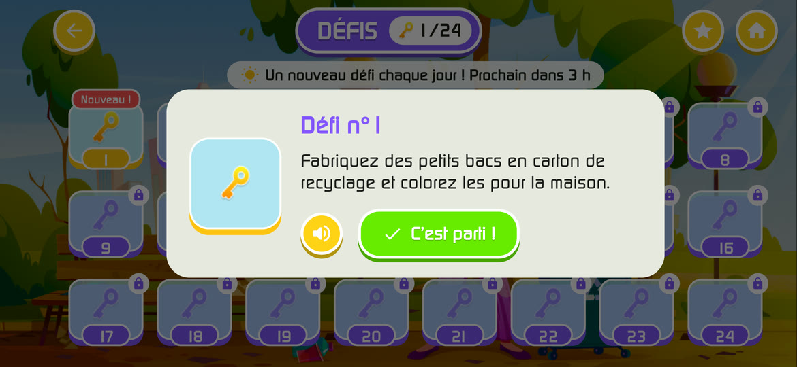</td>
  </tr>
  <tr>
    <td>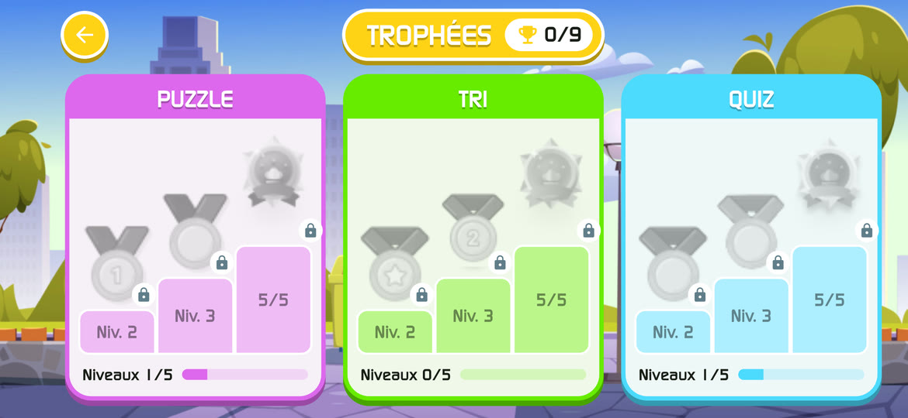</td>
    <td>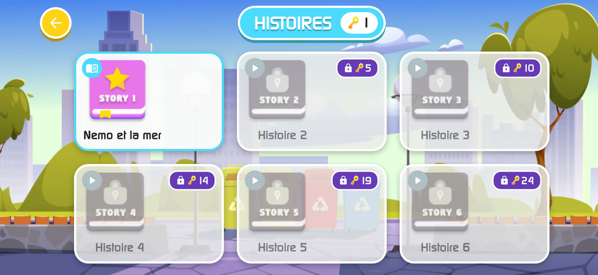</td>
  </tr>
  <tr>
    <td>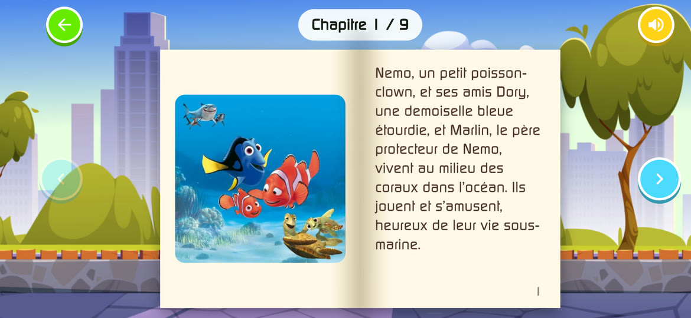</td>
    <td>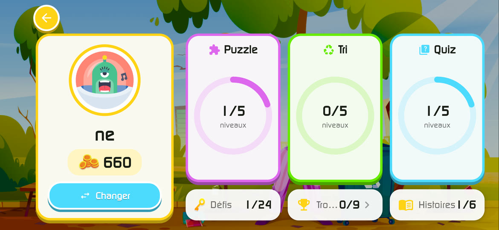</td>
  </tr>
</table>

### Compte parent et réglages

<table>
  <tr>
    <td>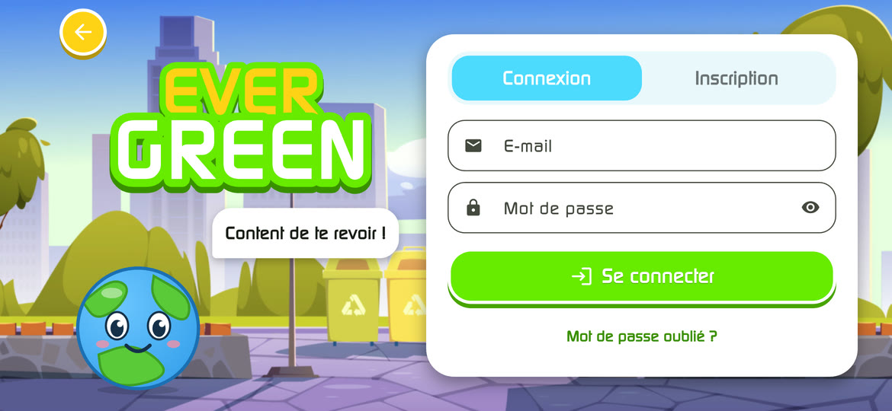</td>
    <td>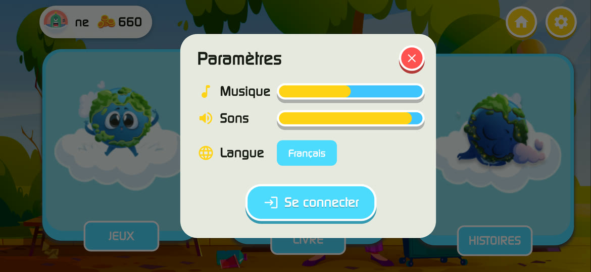</td>
  </tr>
</table>

## Nouveautés de la v2.0

* **Refonte complète de l'interface** : boutons tactiles, transitions animées entre les écrans, écran de démarrage animé avec Terry et un logo vectoriel net à toutes les tailles.
* **Profils** : choix « Qui joue ? », création et modification de profils avec avatar, profil détaillé, classement en ligne avec podium.
* **Puzzle** : vraies pièces découpées, éparpillées autour du plateau, avec aimantation et chronomètre.
* **Livre** : pages qui se tournent comme un vrai livre, navigation par chapitres.
* **Quiz, tri et défis** : retours visuels et sonores, explications après chaque question, défi quotidien.
* **Trophées** par jeu et par niveau.
* **Connexion, inscription et mot de passe oublié** réunis dans une seule page, messages d'erreur en français, vérification de l'e-mail.
* **Audio** : la musique se met en pause quand l'application passe en arrière-plan.
* **Sécurité** : règles Firestore (chaque famille ne voit que ses données, classement en lecture seule pour les autres).
* **Technique** : passage à Flutter 3.47 / Dart 3.13, Android Gradle Plugin 9, nombreuses corrections de bugs, tests unitaires.

## Installation

Téléchargez l'APK depuis la page [Releases](https://github.com/MahrazAbdelrahmen/EVERGREEN/releases/latest) et ouvrez-le sur votre téléphone Android (autorisez l'installation depuis des sources inconnues si demandé).

* `app-arm64-v8a-release.apk` : la plupart des téléphones récents.
* `app-armeabi-v7a-release.apk` : anciens téléphones 32 bits.
* `app-release.apk` : version universelle, si vous ne savez pas laquelle choisir.

## Auteurs

* [CHERGUELAINE Oussama](https://github.com/ousscher)
* [MAHRAZ Abderahman](https://github.com/MahrazAbdelrahmen)
* [BELHARDA Aya]
* [KADRI Lyna]
* [TOUTOU Salsabila]
* [CHERRAF Nourelhouda]

## Charte graphique

| Couleur | Code Hexadécimal |
| ------- | ---------------- |
| bleu clair |  #4CDAFE |
| beige foncé |  #FFD217 |
| vert |  #67EB00 |
| mauve clair |  #DD67ED |

## Guide d'utilisation

* [Notice d’utilisation PDF](https://drive.google.com/file/d/1eJQVIbXojgwJAjK8qin-A1Yq0Aaun63N/view?usp=sharing)

## Guide d’installation

* [Notice d’installation PDF](https://drive.google.com/file/d/1Ip1xgkHyk78BL5WucTI9bh4KQ6w3NnVH/view?usp=sharing)

## Développement

Le code de l'application se trouve dans `Projet/`. Il nécessite Flutter 3.47+ (Dart 3.13+) et un JDK 17.

```bash
cd Projet
flutter pub get
flutter test
flutter run
```

* Après une modification de `lib/BackEnd/PlayerProgress/player.dart`, régénérer les adaptateurs Hive avec `dart run build_runner build`.
* **Règles Firestore** : elles sont dans `Projet/firestore.rules`. Pour les déployer : `npm install -g firebase-tools`, `firebase login`, puis `firebase deploy --only firestore:rules` depuis `Projet/`.
* **iOS** : ajouter `GoogleService-Info.plist` (ou lancer `flutterfire configure`) avant de compiler pour iOS.

### Build release Android

1. Créer une clé de signature (une seule fois, à conserver précieusement) :
   ```bash
   keytool -genkey -v -keystore ~/evergreen-release.jks -keyalg RSA -keysize 2048 -validity 10000 -alias evergreen
   ```
2. Créer `Projet/android/key.properties` (jamais versionné) :
   ```properties
   storeFile=C:/Users/<vous>/evergreen-release.jks
   storePassword=<mot de passe>
   keyAlias=evergreen
   keyPassword=<mot de passe>
   ```
   Sans ce fichier, la build release est signée avec la clé de debug.
3. Compiler :
   ```bash
   flutter build apk --release --split-per-abi   # un APK par architecture
   flutter build apk --release                   # APK universel
   ```
   Les APK se trouvent dans `Projet/build/app/outputs/flutter-apk/`.

## Remerciement

* Nous souhaitons exprimer nos sincères remerciements à Mr Balla A. et Mme Bourai S. pour leur encadrement précieux tout au long de ce projet. Leur expertise, leurs conseils et leur soutien nous ont permis de mener à bien notre travail.
* Un grand merci à vous, utilisateurs de notre projet, pour votre confiance et l'utilisation de notre produit au service de votre association caritative.
